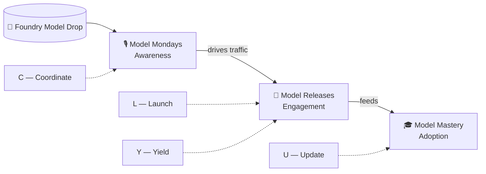

# 🍫 Don't Let the Chocolate Pile Up
### Scaling DevRel Content with AI Agents

**Format:** 25 min + live demos
**Thesis:** We don't need a faster Lucy. We need to make her a fleet: L.U.C.Y.

---

## Act 1 — The Belt Speeds Up (3 min)

Hook: Lucy at the chocolate factory. The belt accelerates. Chocolates in the hat, mouth, blouse.
Supervisor yells *"Speed it up!"*

Reframe for DevRel: every week, Microsoft Foundry ships new models, tools, and optimization
techniques. Each drop is a chocolate on the belt. One person can't wrap them all by hand anymore.

> **Thesis:** Content demand in DevRel now moves like Lucy's belt on overdrive.
> The fix isn't a faster Lucy — it's a fleet.

---

## Act 2 — The Funnel *Is* the Belt (4 min)

Three shows, three funnel stages, three chocolate sizes:

| Stage | Show | Cadence | Chocolate size |
|---|---|---|---|
| 🎙️ Awareness | **Model Mondays** — weekly podcast | Weekly | Small, frequent |
| 🚀 Engagement | **Model Releases** — capsule per model drop | Bursty | Medium, irregular |
| 🎓 Adoption | **Model Mastery** — 4-hr optimization workshop | Quarterly-ish | Large, layered |

> One funnel. Three chocolate sizes. Same belt.

---

## Act 3 — Where the Chocolates Pile Up (3 min)

| Pile | Symptom | Which show hurts most |
|---|---|---|
| 🎩 In the hat — hidden work | Speaker recruiting, calendar holds, tech checks, host assignment | Model Mondays |
| 👄 In the mouth — silently swallowed | Capsule backlog grows faster than models ship | Model Releases |
| 👚 In the blouse — stuffed for later | *"I'll refresh that notebook next sprint"* | Model Releases |
| 🗑️ On the floor — dropped | Workshop labs go stale after model deprecations | Model Mastery |

> You can't out-hustle the belt. You have to build a fleet.

---

## Act 4 — Meet L.U.C.Y (2 min)

Not a faster Lucy. A fleet, named for what it does:

- **L**aunch — scaffold new content from scratch (capsules, recaps)
- **U**pdate — refresh stale content as models/SDKs change
- **C**oordinate — own the PM/ops grind (scheduling, speaker confirms, tech checks)
- **Y**ield — scale output in parallel across a whole model lineup

> Same DevRel. Same belt. New crew: L.U.C.Y.

---

## Act 5 — L.U.C.Y at Work: Live Demos (9 min)

Each demo = one L.U.C.Y capability, tied to a real production task on one of the three shows.

- **Demo 1 — 🍬 Skill** *(1.5 min)* → **Model Mondays** *(Coordinate)*. Transcript → recap blog + draft News Highlights segment (5-6 URLs).
- **Demo 2 — 🛠️ Workflow** *(2 min)* → **Model Mondays** *(Coordinate)*. Scheduled workflow handles speaker-confirm reminders, calendar holds, tech-check checklist, and files the Sunday-night rundown.
- **Demo 3 — 🤖 Coding agent** *(2 min)* → **Model Releases** *(Launch)*. Model card + Foundry docs + model characteristics → scaffolded capsule notebook + video script, told through a "hill-climbing" multi-model optimization narrative.
- **Demo 4 — 🚚 Fleet** *(2 min)* → **Model Releases** *(Yield)*. Fan out across a provider's full model lineup — parallel capsule generation/refresh, one session per model.
- **Demo 5 — 🔧 Agentic DevOps** *(1.5 min)* → **Model Mastery** *(Update)*. Model deprecation/update triggers auto-refresh of the e2e optimization lab and the model-specific lab.

---

## Act 6 — The Wrap-Up (2 min)

**Three takeaways:**
1. **Name your chocolates.** Map your funnel — awareness, engagement, adoption — to real recurring artifacts.
2. **Design for the belt, not the burst.** Weekly cadence + agentic workflows beat heroic sprints.
3. **Delegate to the fleet, curate as human.** L.U.C.Y wraps; you taste-test. Judgment is the moat.

> It's time to stop chasing the conveyor belt — and start running your own agent-powered chocolate
> factory. L.U.C.Y has your hat covered. 🍫🤖

---

## Timing

| Section | Time | Cumulative |
|---|---|---|
| Hook + reframe | 3:00 | 3:00 |
| The funnel is the belt | 4:00 | 7:00 |
| Pile-up failure modes | 3:00 | 10:00 |
| Meet L.U.C.Y | 2:00 | 12:00 |
| Live demos (5) | 9:00 | 21:00 |
| Wrap-up | 2:00 | 23:00 |
| **Buffer (Q&A / transitions)** | **2:00** | **25:00** |
