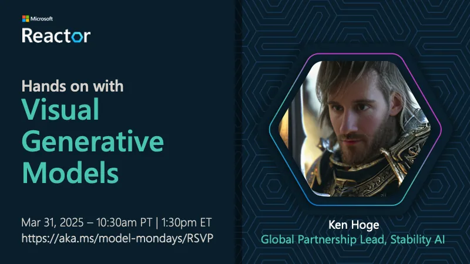

<!-- Imported from https://github.com/microsoft/model-mondays/blob/31a23c47f78aacfaa1da55767a5715acad49966b/docs/model-mondays/2025-04-07-s01-e04.md (MIT, (c) Microsoft Corporation). Regenerate with the refresh-model-mondays-data skill; local edits are overwritten. -->

## News Highlights

(To be added)

## Tech Spotlight

**Title:** Hands on With Visual Generative Models

**Speaker:** Ken Hoge (Stability AI)

**Description:** Exploring visual generative models with Stability AI, focusing on image generation and creative applications.

## Summary

Dive into the fascinating world of Visual Generative Models with Ken Hoge of Stability AI, learning about Stable Diffusion and creative AI.

**Links:**
- [Recording](https://www.youtube.com/watch?v=kDR09m_cUKs&list=PLmsFUfdnGr3wzz6a4E-Szksg92JPng-AL&index=17&pp=iAQB)
- [Blog](https://techcommunity.microsoft.com/blog/machinelearningblog/model-mondays-lights-prompts-action/4398576)
- [Slides](https://speakerdeck.com/nitya/model-mondays-s1-e4-hands-on-with-visual-generative-ai)
