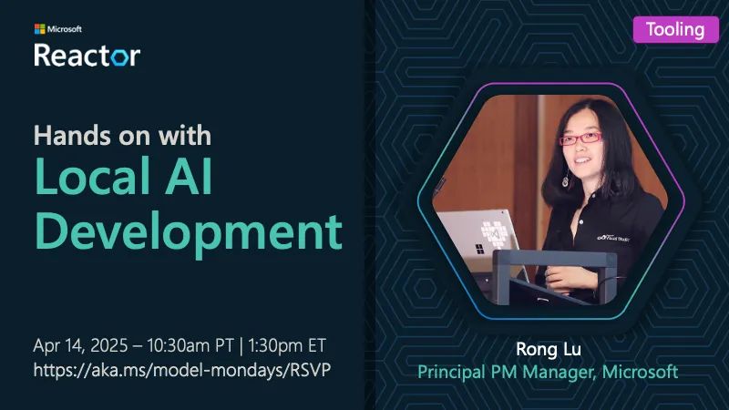

<!-- Imported from https://github.com/microsoft/model-mondays/blob/31a23c47f78aacfaa1da55767a5715acad49966b/docs/model-mondays/2025-04-21-s01-e06.md (MIT, (c) Microsoft Corporation). Regenerate with the refresh-model-mondays-data skill; local edits are overwritten. -->

## News Highlights

(To be added)

## Tech Spotlight

**Title:** Hands on With Local AI Development

**Description:** Bringing AI home with local development using AI Toolkit and on-device models.

## Summary

Explore local AI development with AI Toolkit, learning how to run models on your own hardware.

**Links:**
- [Recording](https://www.youtube.com/watch?v=MgIfvEEZN7o&list=PLmsFUfdnGr3wzz6a4E-Szksg92JPng-AL&index=15&pp=iAQB)
- [Blog](https://techcommunity.microsoft.com/blog/machinelearningblog/model-mondays-bringing-ai-home-with-local-development/4403619)
- [Slides](https://speakerdeck.com/nitya/model-mondays-s1-e6-hands-on-with-local-ai-development)
