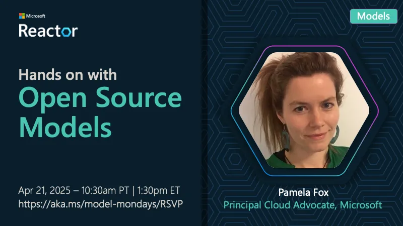

<!-- Imported from https://github.com/microsoft/model-mondays/blob/31a23c47f78aacfaa1da55767a5715acad49966b/docs/model-mondays/2025-04-28-s01-e07.md (MIT, (c) Microsoft Corporation). Regenerate with the refresh-model-mondays-data skill; local edits are overwritten. -->

## News Highlights

(To be added)

## Tech Spotlight

**Title:** Hands on With Open Source Models

**Description:** Exploring open source models with Meta's Llama 4 and the broader open source ecosystem.

## Summary

Dive into the world of open source AI models, exploring Llama 4 and how to leverage open source in your projects.

**Links:**
- [Recording](https://www.youtube.com/watch?v=2E842zOGIyI&list=PLmsFUfdnGr3wzz6a4E-Szksg92JPng-AL&index=14&pp=iAQB)
- [Blog](https://techcommunity.microsoft.com/blog/aiplatformblog/expanding-the-llama-4-herd-new-models-now-available-on-azure-ai-foundry/4403609)
- [Slides](https://speakerdeck.com/nitya/model-mondays-s1-e7-hands-on-with-open-source-models)
