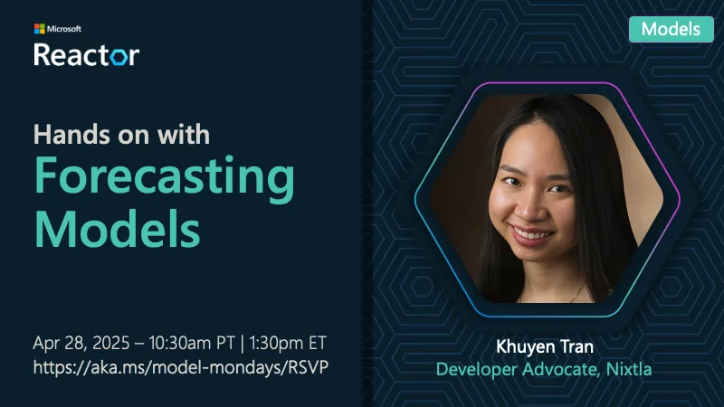

<!-- Imported from https://github.com/microsoft/model-mondays/blob/31a23c47f78aacfaa1da55767a5715acad49966b/docs/model-mondays/2025-05-05-s01-e08.md (MIT, (c) Microsoft Corporation). Regenerate with the refresh-model-mondays-data skill; local edits are overwritten. -->

## News Highlights

(To be added)

## Tech Spotlight

**Title:** Hands on With Forecasting Models

**Speaker:** Nixtla (TimeGEN)

**Description:** Exploring forecasting models and time series prediction with Nixtla's TimeGEN.

## Summary

Learn about forecasting models and how to use them for time series prediction and analysis.

**Links:**
- [Recording](https://www.youtube.com/watch?v=_I6qDdp5Vo4&list=PLmsFUfdnGr3wzz6a4E-Szksg92JPng-AL&index=13&pp=iAQB0gcJCcMJAYcqIYzv)
