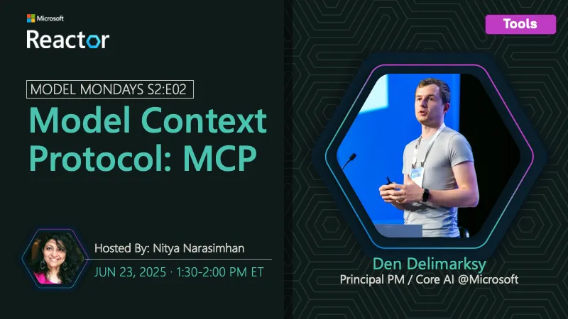

<!-- Imported from https://github.com/microsoft/model-mondays/blob/31a23c47f78aacfaa1da55767a5715acad49966b/docs/model-mondays/2025-06-23-s02-e02.md (MIT, (c) Microsoft Corporation). Regenerate with the refresh-model-mondays-data skill; local edits are overwritten. -->

## News Highlights

(To be added)

## Tech Spotlight

**Title:** Model Context Protocol

**Description:** Understanding Model Context Protocol and how to leverage it for improved model interactions.

**Resources:**
- [Model Context Protocol Documentation](https://modelcontextprotocol.io/)

## Summary

Deep dive into Model Context Protocol (MCP) exploring how it enables better context sharing and model interactions.

**Links:**
- [Recording](https://www.youtube.com/watch?v=cPS3cWRZTps&list=PLmsFUfdnGr3wzz6a4E-Szksg92JPng-AL&index=9&pp=iAQB)
- [Recap](https://github.com/orgs/azure-ai-foundry/discussions/64)
- [Slides](https://speakerdeck.com/nitya/model-mondays-s2e02-model-context-protocol)
- [Blog](https://techcommunity.microsoft.com/blog/educatordeveloperblog/model-mondays-s2e2---understanding-model-context-protocol-mcp/4427914)
