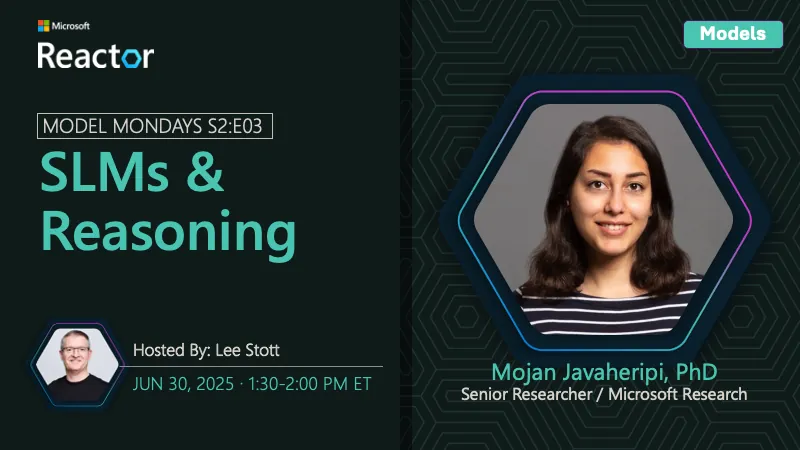

<!-- Imported from https://github.com/microsoft/model-mondays/blob/31a23c47f78aacfaa1da55767a5715acad49966b/docs/model-mondays/2025-06-30-s02-e03.md (MIT, (c) Microsoft Corporation). Regenerate with the refresh-model-mondays-data skill; local edits are overwritten. -->

## News Highlights

(To be added)

## Tech Spotlight

**Title:** SLMs and Reasoning

**Speaker:** Mojan Javaheripi

**Description:** Understanding Small Language Models and how they leverage reasoning capabilities.

## Summary

Exploring Small Language Models (SLMs) and their reasoning capabilities, learning when and how to use them effectively.

**Links:**
- [Recording](https://www.youtube.com/watch?v=VLQKZq8L9Uk&list=PLmsFUfdnGr3wzz6a4E-Szksg92JPng-AL&index=1&pp=iAQB)
- [Recap](https://github.com/orgs/azure-ai-foundry/discussions/76)
- [Slides](https://speakerdeck.com/nitya/model-mondays-s2e02-model-context-protocol)
- [Blog](https://techcommunity.microsoft.com/blog/educatordeveloperblog/s2e3-understanding-slms-and-reasoning-with-mojan-javaheripi/4429758)
