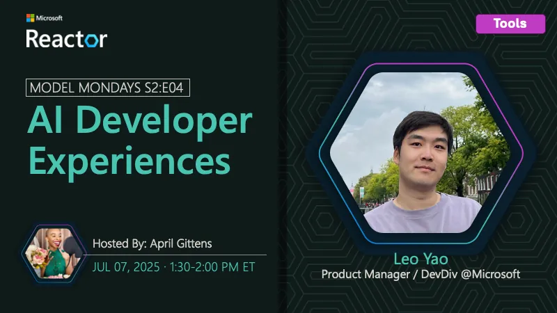

<!-- Imported from https://github.com/microsoft/model-mondays/blob/31a23c47f78aacfaa1da55767a5715acad49966b/docs/model-mondays/2025-07-07-s02-e04.md (MIT, (c) Microsoft Corporation). Regenerate with the refresh-model-mondays-data skill; local edits are overwritten. -->

## News Highlights

(To be added)

## Tech Spotlight

**Title:** AI & Dev Experience

**Speaker:** Leo Yao

**Description:** Understanding how AI is transforming the developer experience with tools and workflows.

## Summary

Exploring AI-powered developer experiences and tools that enhance productivity and code quality.

**Links:**
- [Recording](https://www.youtube.com/watch?v=tNiFbf3XP6k&list=PLmsFUfdnGr3wzz6a4E-Szksg92JPng-AL&index=11&pp=iAQB)
- [Recap](https://discord.gg/azureaifoundry?event=1382861578201858058)
- [Slides](https://speakerdeck.com/nitya/model-mondays-s2e04-ai-developer-experiences)
- [Blog](https://techcommunity.microsoft.com/blog/educatordeveloperblog/s2e4-understanding-ai-developer-experiences-with-leo-yao/4431643)
