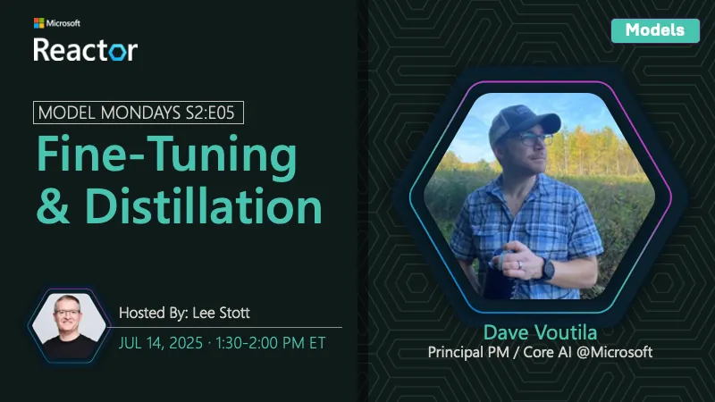

<!-- Imported from https://github.com/microsoft/model-mondays/blob/31a23c47f78aacfaa1da55767a5715acad49966b/docs/model-mondays/2025-07-14-s02-e05.md (MIT, (c) Microsoft Corporation). Regenerate with the refresh-model-mondays-data skill; local edits are overwritten. -->

## News Highlights

(To be added)

## Tech Spotlight

**Title:** Fine-Tuning & Distillation

**Speaker:** Dave Voutila

**Description:** Deep dive into fine-tuning and model distillation techniques for optimizing model performance.

## Summary

Learn about fine-tuning and distillation techniques to customize and optimize models for your specific needs.

**Links:**
- [Recording](https://www.youtube.com/watch?v=VSNGzBB20aw&list=PLmsFUfdnGr3wzz6a4E-Szksg92JPng-AL&index=10&pp=iAQB)
- [Recap](https://discord.gg/azureaifoundry?event=1382862245721014476)
- [Slides](https://speakerdeck.com/nitya/model-mondays-s2e05-fine-tuning-and-distillation)
- [Blog](https://techcommunity.microsoft.com/blog/educatordeveloperblog/model-mondays-s2e5-%E2%80%93-fine-tuning--distillation-with-dave-voutila/4433445)
