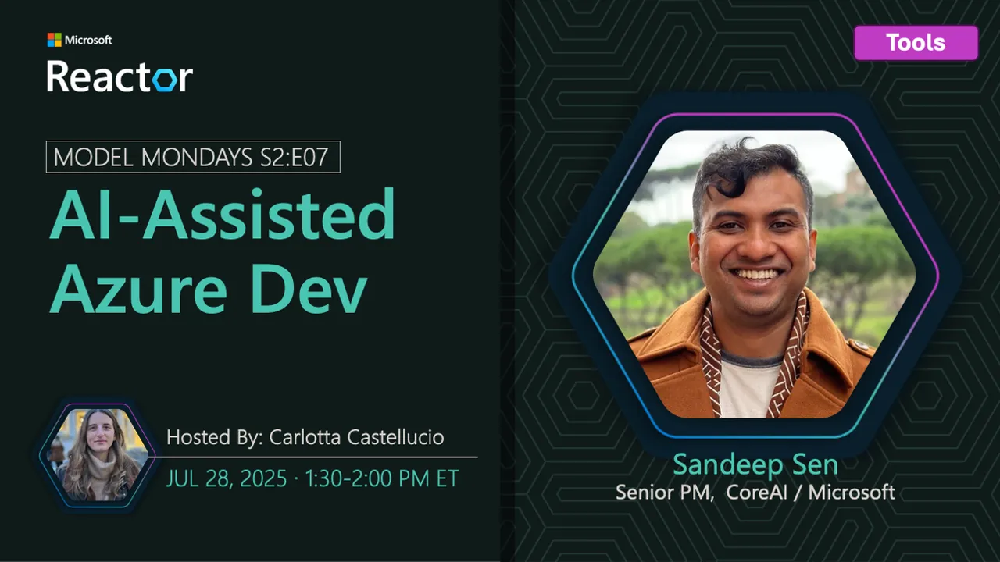

<!-- Imported from https://github.com/microsoft/model-mondays/blob/31a23c47f78aacfaa1da55767a5715acad49966b/docs/model-mondays/2025-07-28-s02-e07.md (MIT, (c) Microsoft Corporation). Regenerate with the refresh-model-mondays-data skill; local edits are overwritten. -->

## News Highlights

(To be added)

## Tech Spotlight

**Title:** AI-Assisted Azure Development

**Description:** Exploring AI-assisted development tools and workflows for Azure applications.

## Customer Story

**Title:** SightMachine Manufacturing AI

**Company:** SightMachine

**Speaker:** Kurt DeMaagd

**Description:** How SightMachine uses AI agents and ML applications for manufacturing predictive maintenance and optimization.

## Summary

Learn about AI-assisted Azure development and hear from SightMachine on manufacturing AI applications.

**Links:**
- [Recording](https://www.youtube.com/watch?v=mSrg1uP136g&list=PLmsFUfdnGr3wzz6a4E-Szksg92JPng-AL&index=8&pp=iAQB)
- [Recap](https://discord.gg/qxuvxPBR?event=1382862912804360354)
- [Slides](https://speakerdeck.com/nitya/model-mondays-s2e07-ai-assisted-azure-development-dd9b8e9e-de8f-45ad-ba0b-beaa3001e507)
- [Blog](https://techcommunity.microsoft.com/blog/educatordeveloperblog/s2e7-%C2%B7-ai-assisted-azure-development/4438177)
