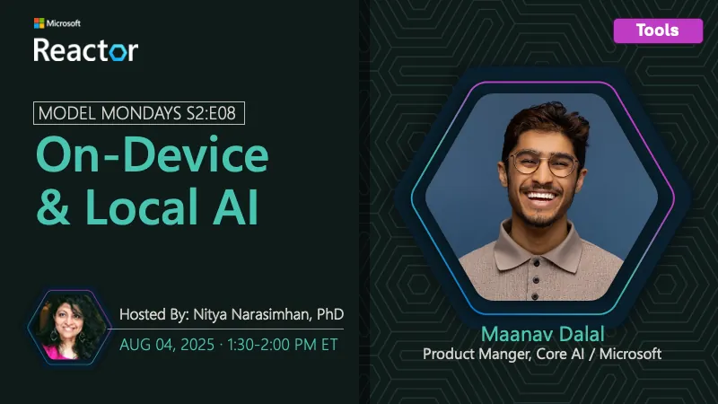

<!-- Imported from https://github.com/microsoft/model-mondays/blob/31a23c47f78aacfaa1da55767a5715acad49966b/docs/model-mondays/2025-08-04-s02-e08.md (MIT, (c) Microsoft Corporation). Regenerate with the refresh-model-mondays-data skill; local edits are overwritten. -->

## News Highlights

(To be added)

## Tech Spotlight

**Title:** On-Device & Local AI

**Description:** Exploring on-device and local AI deployment strategies and best practices.

## Customer Story

**Title:** Xander Memory AI

**Company:** Xander

**Speakers:** Marilyn Morgan Westner, Alex Westner

**Description:** How Xander uses AI to capture and curate personal stories and memories.

## Summary

Deep dive into on-device and local AI capabilities, plus a customer story from Xander on memory AI.

**Links:**
- [Recording](https://www.youtube.com/watch?v=ILBDDCJ0d9g&list=PLmsFUfdnGr3wzz6a4E-Szksg92JPng-AL&index=7&pp=iAQB)
- [Recap](https://discord.gg/azureaifoundry?event=1382863345777901670)
- [Slides](https://speakerdeck.com/nitya/model-mondays-s2e08-on-device-and-local-ai)
- [Blog](https://techcommunity.microsoft.com/blog/educatordeveloperblog/model-mondays-s2e8-on-device--local-ai/4440693)
