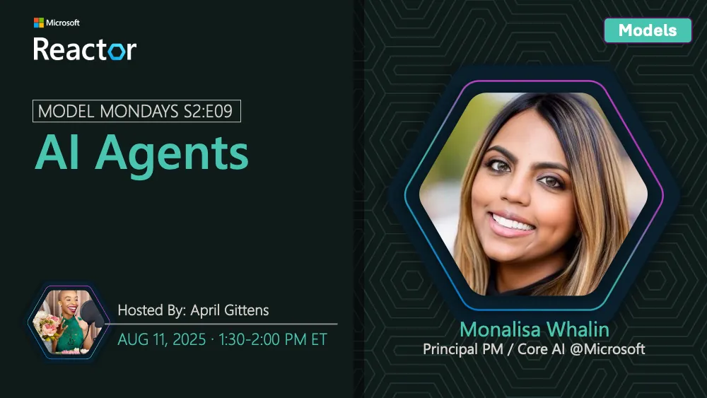

<!-- Imported from https://github.com/microsoft/model-mondays/blob/31a23c47f78aacfaa1da55767a5715acad49966b/docs/model-mondays/2025-08-11-s02-e09.md (MIT, (c) Microsoft Corporation). Regenerate with the refresh-model-mondays-data skill; local edits are overwritten. -->

## News Highlights

(To be added)

## Tech Spotlight

**Title:** AI Agents

**Description:** Understanding AI agents and how to build autonomous systems with models.

## Customer Story

**Title:** Atomicwork Agentic Systems

**Company:** Atomicwork

**Speaker:** Sukrit Chatterjee

**Description:** How Atomicwork designs integrated AI systems that learn and adapt to task context.

## Summary

Explore AI agents and autonomous systems, plus a customer story from Atomicwork on agentic AI.

**Links:**
- [Recording](https://www.youtube.com/watch?v=fjSxraAmGMI&list=PLmsFUfdnGr3wzz6a4E-Szksg92JPng-AL&index=6&pp=iAQB0gcJCcMJAYcqIYzv)
- [Recap](https://discord.gg/azureaifoundry?event=1382863654961025174)
- [Slides](https://speakerdeck.com/nitya/model-mondays-s2e09-ai-agents)
- [Blog](https://techcommunity.microsoft.com/blog/educatordeveloperblog/model-mondays-s2e9-models-for-ai-agents/4443162)
