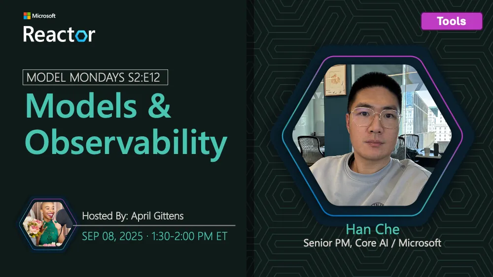

<!-- Imported from https://github.com/microsoft/model-mondays/blob/31a23c47f78aacfaa1da55767a5715acad49966b/docs/model-mondays/2025-09-08-s02-e12.md (MIT, (c) Microsoft Corporation). Regenerate with the refresh-model-mondays-data skill; local edits are overwritten. -->

## News Highlights

(To be added)

## Tech Spotlight

**Title:** Models & Observability

**Description:** Understanding model observability and monitoring for production AI systems.

## Customer Story

**Title:** Saifr Compliance AI

**Company:** Saifr

**Speakers:** David Johnston, Brett Trainor

**Description:** How Saifr's AI solutions help financial service developers create compliant apps and agents.

## Summary

Explore model observability and monitoring, plus a customer story from Saifr on compliance AI.

**Links:**
- [Recording](https://www.youtube.com/watch?v=gEH2ACNf5b0&list=PLmsFUfdnGr3wzz6a4E-Szksg92JPng-AL&index=3&pp=iAQB)
- [Recap](https://discord.gg/azureaifoundry?event=1382864811649536120)
- [Slides](https://speakerdeck.com/nitya/model-mondays-s2e12-models-and-observability)
- [Blog](https://techcommunity.microsoft.com/blog/educatordeveloperblog/model-mondays-s2e12-models--observability/4452789)
