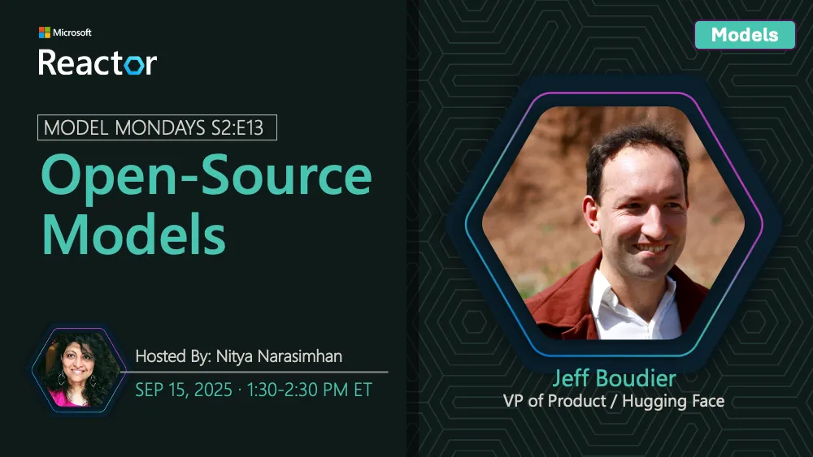

<!-- Imported from https://github.com/microsoft/model-mondays/blob/31a23c47f78aacfaa1da55767a5715acad49966b/docs/model-mondays/2025-09-15-s02-e13.md (MIT, (c) Microsoft Corporation). Regenerate with the refresh-model-mondays-data skill; local edits are overwritten. -->

## News Highlights

(To be added)

## Tech Spotlight

**Title:** Open-Source Models (Hugging Face)

**Description:** Exploring the world of open-source models with Hugging Face integration.

## Customer Story

**Title:** DraftWise Legal AI

**Company:** DraftWise

**Speaker:** James Ding

**Description:** How AI models are revolutionizing legal contracting with DraftWise.

## Summary

Deep dive into open-source models and Hugging Face, plus a customer story from DraftWise on legal AI.

**Links:**
- [Recording](https://www.youtube.com/watch?v=BANtEq-0FsE)
- [Recap](https://discord.gg/Z8JZsrP5P5?event=1414657387062628442)
- [Slides](https://speakerdeck.com/nitya/model-mondays-s2e13-open-source-models-and-hugging-face)
- [Blog](https://techcommunity.microsoft.com/blog/educatordeveloperblog/model-mondays-s2e13-open-source-models-hugging-face/4454335)
