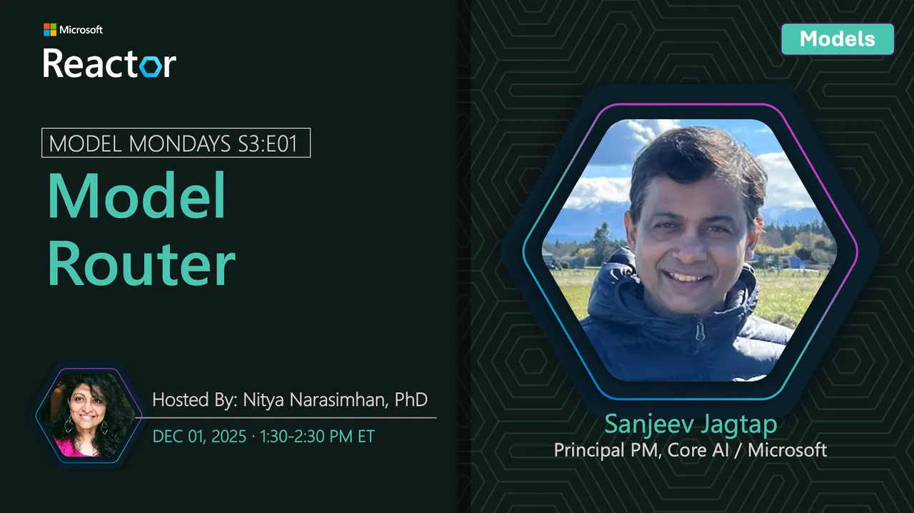

<!-- Imported from https://github.com/microsoft/model-mondays/blob/31a23c47f78aacfaa1da55767a5715acad49966b/docs/model-mondays/2025-12-01-s03-e01.md (MIT, (c) Microsoft Corporation). Regenerate with the refresh-model-mondays-data skill; local edits are overwritten. -->

## News Highlights

- [Model Router GA Announcement](https://ignite.microsoft.com) - Microsoft Foundry Model Router reaches general availability at Ignite 2025.

## Tech Spotlight

**Title:** Model Router Deep Dive

**Speaker:** [Sanjeev Jagtap](https://linkedin.com/in/sanjeevjagtap)

_Sanjeev is a Core AI PM Lead at Microsoft, focusing on model routing and AI infrastructure. He leads the development of Model Router and other intelligent routing capabilities in Microsoft Foundry._

**Description:** Core AI PM Lead Sanjeev Jagtap discusses the GA announcement at Microsoft Ignite and demonstrates real-world applications.

**Resources:**
- [Ignite Theater Session THR722](https://ignite.microsoft.com/en-US/sessions/THR722)
- [AI Tour Lab: Automate Model Selection](https://github.com/microsoft/aitour26-LTG153-automate-model-selection-and-ai-app-design-with-microsoft-foundry)

## Customer Story

**Title:** Adobe Document Intelligence

**Company:** Adobe

**Description:** How Adobe leverages model routing for document processing at scale.

## Summary

What if you could always pick the perfect model, instantly? See Foundry Model Router make split-second decisions that save money and boost performance.

**Study Corner:** L0: Introduction to Models for Beginners

**Tags:** model-router, automation, cost-optimization, ignite, foundry

**Links:**
- [Registration](https://aka.ms/model-mondays/rsvp)
- [Recording](https://img.youtube.com/vi/zE1tfuPGfFY/hqdefault.jpg)
