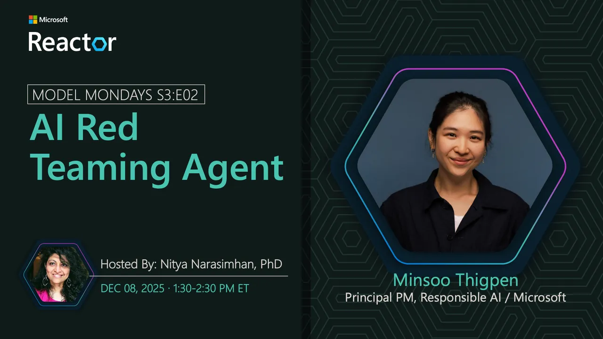

<!-- Imported from https://github.com/microsoft/model-mondays/blob/31a23c47f78aacfaa1da55767a5715acad49966b/docs/model-mondays/2025-12-08-s03-e02.md (MIT, (c) Microsoft Corporation). Regenerate with the refresh-model-mondays-data skill; local edits are overwritten. -->

## News Highlights

(To be added)

## Tech Spotlight

**Title:** AI Red Teaming Agent in Microsoft Foundry

**Description:** Hands-on exploration of automated red teaming tools and techniques for securing AI applications.

**Resources:**
- [Ignite Lab: Safeguard Your Agents](https://github.com/microsoft/ignite25-LAB516-safeguard-your-agents-with-ai-red-teaming-agent-in-microsoft-foundry)

## Summary

Learn how to safeguard your AI agents with red teaming techniques and automated adversarial testing in Microsoft Foundry.

**Study Corner:** L1: Language Models

**Tags:** red-teaming, security, responsible-ai, ignite, safety

**Links:**
- [Registration](https://aka.ms/model-mondays/rsvp)
