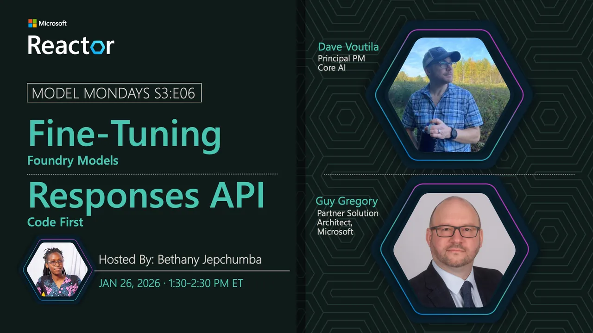

<!-- Imported from https://github.com/microsoft/model-mondays/blob/31a23c47f78aacfaa1da55767a5715acad49966b/docs/model-mondays/2026-01-19-s03-e05.md (MIT, (c) Microsoft Corporation). Regenerate with the refresh-model-mondays-data skill; local edits are overwritten. -->

## Responses API

**Date:** January 19, 2026  
**Season:** 3 | **Episode:** 5  
**Host:** Nitya Narasimhan

### News Highlights

1. [OpenAI Responses API](https://aka.ms/model-mondays) - Unified API for agent creation
2. [Chat Completion Updates](https://aka.ms/model-mondays) - Latest enhancements and features
3. [Assistants API Evolution](https://aka.ms/model-mondays) - New capabilities and integrations
4. [Agent Development](https://aka.ms/model-mondays) - Streamlined workflow for building agents
5. [Microsoft Foundry Integration](https://aka.ms/model-mondays) - Seamless integration with Foundry services

### Tech Spotlight: Responses API

The Responses API is a stateful API from OpenAI that unifies the chat completion and assistants API capabilities in one experience to streamline your agent creation workflow in Microsoft Foundry.

**Key Features:**
- Unified interface for chat and assistants capabilities
- Stateful conversation management
- Simplified agent development workflow
- Native integration with Microsoft Foundry
- Enhanced context handling and memory

**Speaker:** [Guy Gregory](https://linkedin.com/in/guygregory)

_Guy is a Principal Product Manager at Microsoft, specializing in fine-tuning, the Responses API, and model customization capabilities. He works on making agent creation more accessible and streamlined for developers._

**Resources:**
- [Responses API Documentation](https://aka.ms/model-mondays)
- [Migration Guide](https://aka.ms/model-mondays)
- [Code Samples](https://aka.ms/model-mondays)

### Summary

Join us as Guy Gregory demonstrates the Responses API and explains why this technology matters for agent development. Learn how it streamlines the agent creation workflow by unifying chat completion and assistants API capabilities into a single, cohesive experience on Microsoft Foundry.

**Related AMA:** [View AMA Discussion](https://github.com/microsoft/model-mondays/blob/31a23c47f78aacfaa1da55767a5715acad49966b/docs/foundry-fridays/2026-01-23-ama-035.md)
