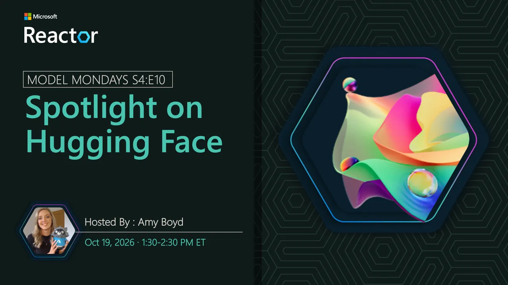

<!-- Imported from https://github.com/microsoft/model-mondays/blob/31a23c47f78aacfaa1da55767a5715acad49966b/docs/model-mondays/2026-10-19-s04-e10.md (MIT, (c) Microsoft Corporation). Regenerate with the refresh-model-mondays-data skill; local edits are overwritten. -->

# Spotlight on Hugging Face

**Date:** October 19, 2026 
**Season:** 4 | **Episode:** 10 
**Host:** Amy Boyd

## Overview

Hugging Face expands the range of open models developers can discover, while Managed Compute provides the infrastructure needed to deploy and run selected models for real-time inference. Join us as we explore this workflow in Microsoft Foundry and see how an open model can move from the catalog into a working AI agent.
